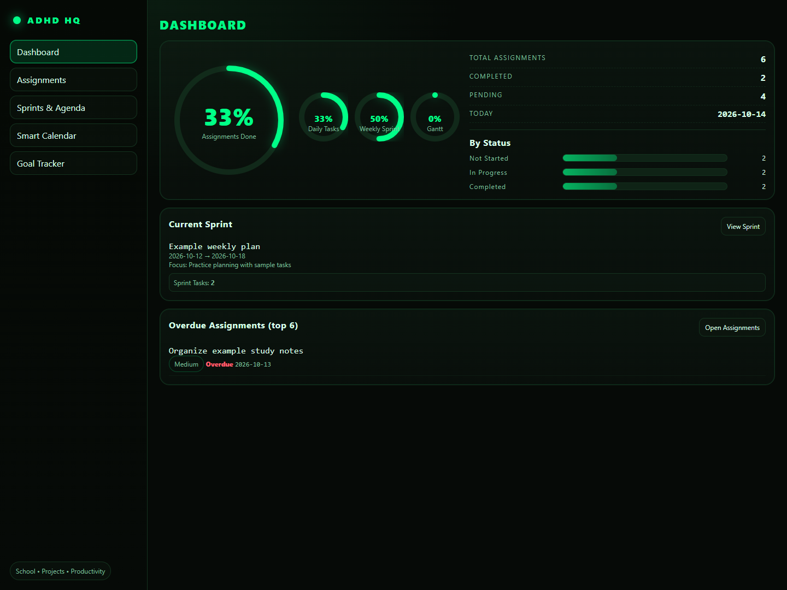

# ADHD HQ

## Problem

I wanted one place to keep track of assignments, daily work, and longer projects. A task list could tell me what needed doing, but it did not show how that work fit into the week or how close a larger goal was to being finished.

I also wanted the planner to work as a desktop app without an account or a hosted service. Keeping the data on my computer made more sense for something I use to organize my own work.

## Solution

I built ADHD HQ around a dashboard, assignments, weekly sprints, a calendar, goals, and a Gantt timeline. Tasks can have priorities, deadlines, notes, and links to a sprint or milestone, so I can move between the daily details and the bigger plan without keeping separate lists.

The desktop window runs the same interface as the local web app. Everything saves to SQLite, and the public examples use fictional School and Projects tasks. The dashboard below uses those examples; personal assignments, goals, and databases are not included in the source.



## Stack and Explanation

| Part of the source | Stack | What it does and why |
| --- | --- | --- |
| `desktop.py` | Python, pywebview, Windows WebView2 | Opens the native window and manages the local server. This lets the desktop app reuse the web interface. |
| `app.py` | FastAPI, Uvicorn, python-multipart | Serves pages, validates forms, and calculates dashboard, sprint, and calendar data. Python keeps these rules close to the storage code. |
| `templates/` | Jinja2, HTML, SVG | Renders planner pages and dashboard progress rings on the server, keeping the frontend build simple. |
| `static/css/style.css` | CSS | Provides shared styling, focus states, and layouts for smaller windows. |
| `static/js/` | Vanilla JavaScript | Handles form feedback and Gantt dragging, resizing, and saves without a frontend framework. |
| `db.py` | SQLite, Python sqlite3, SQL | Defines tables, migrations, and parameterized queries. One database file fits a local, single-user app. |
| `config.json` | JSON | Defines work areas, categories, priorities, and statuses in one place. |
| `import_database.py` | Python, SQLite | Checks an older database before importing it and refuses to overwrite an existing destination. |
| `ADHD_HQ.spec`, requirements files | PyInstaller, pip | Packages the Python app, templates, and assets for Windows while excluding user databases. |
| `tests/` | pytest, Node's test runner; Ruff for linting | Checks routes, planning links, sample-data isolation, calendar dates, and Gantt calculations. |

A page or form request goes through FastAPI to `db.py`. Jinja renders the response; JavaScript saves timeline changes through local routes and restores the previous position if a save fails. The API includes `/healthz` and `/api/stats`. There are no external APIs or paid services, and the server stays on `127.0.0.1` because the app has no multi-user authentication.

Use Python 3.12 for the tested development environment:

```powershell
py -3.12 -m venv .venv
.\.venv\Scripts\python.exe -m pip install -r requirements-dev.txt
.\.venv\Scripts\python.exe desktop.py
```

The normal Windows database is `%LOCALAPPDATA%\ADHD HQ\taskhq.db`. `ADHD_HQ_DATA_DIR` selects another folder. To try the fictional goals and assignments in a separate workspace:

```powershell
$env:ADHD_HQ_DATA_DIR = "$PWD\sample-data"
$env:ADHD_HQ_DEMO = "1"
.\.venv\Scripts\python.exe desktop.py
```

Examples are added once to a new empty workspace. Close the app before backing up its database, and keep databases and sample-data folders outside Git.

```powershell
.\.venv\Scripts\python.exe -m pytest -q
node --test tests/gantt.test.cjs
.\.venv\Scripts\python.exe -m ruff check .
.\.venv\Scripts\python.exe -m PyInstaller --noconfirm ADHD_HQ.spec
```

The current tests pass: 10 Python checks and 3 JavaScript checks. The build outputs `dist\ADHD HQ\ADHD HQ.exe`; keep it beside its `_internal` folder. Windows needs WebView2. Packaging is unsigned, and fresh-machine, macOS, and Linux installation have not been verified.
